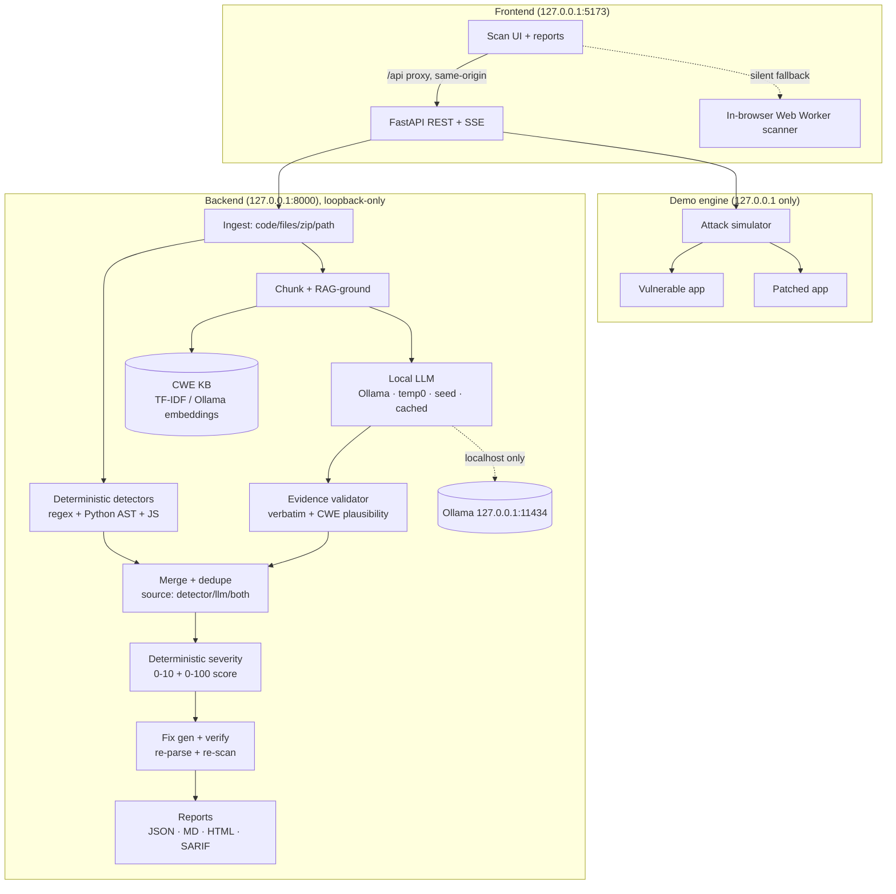

# 🐒 ChaosMonkey

**Shake the code before it ships.** ChaosMonkey is a security checkpoint for AI-generated
("vibe coded") code. It analyzes code **before deployment** to find vulnerabilities, exposed
API keys/secrets, and unsafe handling of personal data — grounds every finding in a CWE
knowledge base, validates it against the real code, scores severity deterministically, and
hands you a verified fix.

**Everything runs on your machine.** Analysis uses a self-hosted, deterministic local LLM
(Ollama, off by default) with an offline fallback; model calls are restricted to loopback. The server
binds to `127.0.0.1` and refuses to start if any configured endpoint is non-local.

Built at Cal Hacks 13.0.

## What it does

Point ChaosMonkey at a project folder, pasted code or a zip. It reports:

- **Exposed secrets**: API keys (OpenAI, Stripe, AWS, GitHub, …), private keys, passwords and
  tokens hard-coded in source or committed `.env` files.
- **Personal data (PII)**: emails, phone numbers, SSNs and card numbers in code, seed data and
  logs.
- **Vulnerabilities**: SQL injection, command injection, XSS, path traversal, `eval`, weak
  password hashing, disabled TLS checks, debug mode left on, wildcard CORS, unsafe browser
  storage and more.

Each finding comes with:

- the exact file and line, with secret values **masked** (`sk-••••••••a91f`);
- the CWE it maps to, plus a plain-English explanation and a realistic attack scenario;
- a deterministic severity and an overall 0–100 security score;
- a suggested fix as a diff. The fix is marked **verified** only after ChaosMonkey applied it to
  a copy, confirmed the file still parses, and re-scanned to confirm the issue is gone.

You can export the report as Markdown, JSON, HTML or SARIF. With the
[Claude Code plugin](claude-code-plugin/README.md), ChaosMonkey also checks the code an AI
agent just wrote. You then approve fixes in a browser and they're applied to your project.

## Why not just ask an AI to review my code?

You can paste code into a chatbot and ask "is this secure?". ChaosMonkey is built to be more
reliable than that, in specific ways:

| Asking an AI assistant | ChaosMonkey |
| --- | --- |
| **Different answer each time.** Run the same prompt twice and you can get different findings. | **Deterministic.** Same code, same report, byte for byte (fixed seed, temperature 0, cached results, stable finding ids). `GET /api/determinism-check` proves it. |
| **Can invent problems or miss real ones.** It only reports what the model happens to notice. | **Rule-based detectors run every time.** Regex, Python AST and JS rules run without any AI. If a local model is used, each finding must quote code that exists **verbatim** in your file and match a known CWE pattern, or it's thrown away. |
| **Your code, and the secrets in it, go to a cloud service.** Asking "do I have leaked keys?" sends the keys too. | **Nothing leaves your machine.** The server only talks to `127.0.0.1` and refuses to start otherwise. Secret values are masked before they're shown, logged, exported, or handed to Claude Code. |
| **Fixes are suggestions you have to trust.** | **Fixes are checked.** Each patch is re-parsed and re-scanned before it's marked verified. With the plugin, applied fixes are backed up first and verified again on the real project. |
| **Works only when a model is available.** | **Works with no AI at all.** Detection is always deterministic. Local AI (Ollama) is off by default and only adds explanations when you switch it on. The UI always shows which mode ran. |

ChaosMonkey isn't a replacement for a security audit. See [Limitations](#limitations-honest).
It's a fast, repeatable checkpoint to run before AI-written code ships.

## Repository layout

| Folder | What's in it |
| --- | --- |
| [`frontend/`](frontend/) | React + Vite + TypeScript app: scanner UI, rule registry, reports. Fully offline. |
| [`backend/`](backend/) | FastAPI analysis pipeline, CWE RAG, local-LLM layer, reports, and the demo engine. |
| [`demo/`](demo/) | 3 deliberately vulnerable apps (vulnerable + patched) and the attack simulator. |
| [`data/`](data/) | `cwe_seed.json` — the grounded CWE knowledge base (32 entries). |
| [`scripts/`](scripts/) | `setup.sh`, `run.sh`, `build_cwe_seed.py`, `ingest_cwe.py`. |
| [`claude-code-plugin/`](claude-code-plugin/) | Claude Code plugin: offers a scan after Claude changes code, opens the report in the local UI, and applies only the fixes you approve. |

See [`API.md`](API.md) for the full endpoint contract.

## Architecture



## Get started

### 1. Download

```bash
git clone https://github.com/ishver928/ChaosMonkey-Official.git
cd ChaosMonkey-Official
```

No Git? On the GitHub page, click **Code → Download ZIP**, unzip it, and open a terminal in
the unzipped folder.

### 2. Install the prerequisites

| Tool | Needed for | Get it |
| --- | --- | --- |
| **Node.js 18+** | the web UI (and the Claude Code plugin) | https://nodejs.org |
| **Python 3.11+** | the analysis backend | https://python.org (Windows: tick "Add python.exe to PATH") |
| Git | cloning, and the Claude Code plugin's marketplace step | https://git-scm.com |
| Ollama *(optional)* | AI-written explanations from a local model | https://ollama.com, then `ollama pull qwen2.5-coder:7b-instruct` and start the backend with `AI_ENABLED=1` |
| Docker *(optional)* | the sandbox "is this really exploitable?" check | https://docker.com |

Without Ollama, or with local AI left off (the default), everything still works in detector-only mode.

### 3. Pick how you want to use it

#### Option A: just the browser app (fastest, no Python)

```bash
cd frontend
npm install
npm run dev          # opens http://127.0.0.1:5173
```

Drop in a folder or paste code, or click **Load demo project**. Scanning runs entirely inside
your browser tab.

#### Option B: the full app (backend pipeline + UI on one port)

macOS / Linux:

```bash
scripts/setup.sh                                   # creates backend/.venv and installs dependencies
(cd frontend && npm install && npm run build)      # builds the UI the backend serves
scripts/run.sh                                     # http://127.0.0.1:8000
```

Windows (PowerShell):

```powershell
cd backend
python -m venv .venv
.\.venv\Scripts\python -m pip install -r requirements.txt
cd ..\frontend
npm install
npm run build
cd ..\backend
.\.venv\Scripts\python -m uvicorn app.main:app --host 127.0.0.1 --port 8000
```

Open **http://127.0.0.1:8000** in your browser. To check that it's private, open
`http://127.0.0.1:8000/api/health` and look for `"data_leaves_machine": false`. For a fully
offline demo with recorded model answers, start it with `LLM_MOCK=1` (PowerShell:
`$env:LLM_MOCK="1"` first).

#### Option C: inside Claude Code (checks the code your AI agent writes)

Do the setup from Option B, minus starting the server (the plugin starts it for you). Then,
from the repo root:

```bash
node claude-code-plugin/scripts/register-home.js
claude plugin marketplace add ./claude-code-plugin
claude plugin install chaosmonkey@chaosmonkey-local
```

Open Claude Code in any project and run **`/chaosmonkey:enable`**. The ChaosMonkey UI opens in
your browser. From then on, whenever Claude finishes changing your code, it asks **"Run
ChaosMonkey security analysis? (Y/N)"**. Say yes and the report appears in that tab. Tick the
fixes you want, click **Apply approved fixes to my project**, and Claude is told what changed.
Nothing is ever applied without your click, and originals are backed up in
`.chaosmonkey/backups/`. Full details: [`claude-code-plugin/README.md`](claude-code-plugin/README.md).

### Developing on the frontend with the backend

`npm run dev` in `frontend/` proxies `/api` to the backend on `127.0.0.1:8000`. If the backend
isn't running, the app quietly falls back to the in-browser scanner.

## API summary

| Method | Path | Purpose |
| --- | --- | --- |
| GET | `/api/health` | Model status, KB size, **privacy attestation** (`data_leaves_machine: false`). |
| POST | `/api/scan` | Scan pasted code / files / zip / a directory path → `scan_id`. |
| GET | `/api/scan/{id}` | Status + results. |
| GET | `/api/scan/{id}/events` | SSE: live per-stage and per-finding progress. |
| GET | `/api/scan/{id}/report?format=json\|md\|html\|sarif` | Export the report. |
| POST | `/api/scan/{id}/apply-fixes` | Patched copy + combined diff. |
| GET | `/api/cwe/{id}`, `/api/cwe/search?q=` | CWE knowledge base. |
| GET | `/api/determinism-check` | Run the same scan twice; prove identical output. |
| GET | `/api/demo/scenarios` | List demo scenarios. |
| POST | `/api/demo/{s}/attack\|scan\|fix\|replay\|full\|reset` | The live demo flow (SSE). |

Full details in [`API.md`](API.md).

## 90-second demo script (for judges)

1. **Health (5s).** `curl 127.0.0.1:8000/api/health` → `"data_leaves_machine": false` and a
   `local_only` check: the model URL is loopback, proxy env vars are ignored, redirects are not
   followed. The model, digest, seed and generation options are listed.
2. **Attack the vulnerable app (20s).**
   `curl -N -X POST "127.0.0.1:8000/api/demo/flask_store/attack?target=vulnerable"`
   → watch **5/5 COMPROMISED**: SQL-injection login bypass, unauth `/admin` data dump, `../`
   path traversal of a canary file, reflected XSS, and a scraped (fake) API key.
3. **Scan it (20s).** `curl -N -X POST 127.0.0.1:8000/api/demo/flask_store/scan`
   → a grounded report: CWE-89, CWE-798, CWE-79, CWE-22, CWE-328, CWE-489… each with verbatim
   evidence and a verified fix. Security score ~60/100.
4. **Fix + re-attack (20s).** `curl -N -X POST 127.0.0.1:8000/api/demo/flask_store/full`
   → one stream: attack → scan → fix → **replay the same attacks → 0/5 COMPROMISED**, security
   score **60 → 80**.
5. **Determinism + privacy (10s).** `curl 127.0.0.1:8000/api/determinism-check` → `"identical": true`.
   Same input, byte-identical report, every time, all locally.

One-liner for the whole thing: the **Chaos Mode** toggle (`"chaos_mode": true` on `/api/scan`)
injects known-vulnerable snippets into a copy of your code and reports the detection rate — the
"monkey" shaking your code to prove the checker works.

## What is enforced, and how

- **Loopback-only model calls.** The server binds to loopback and aborts startup if Ollama's URL is
  not loopback. Every model request goes through `backend/app/llm/client.py`, which re-checks the
  URL before sending, ignores proxy env vars (`trust_env=False`) and does not follow redirects. A
  test with a socket-level guard shows a full scan opens no non-loopback connection.
  `/api/health` exposes `data_leaves_machine` and the `local_only` check. No cloud AI SDKs are
  imported anywhere.
- **No raw secrets in output.** Every secret/PII value is masked before it is logged, stored,
  returned, or placed in a report or fix diff; a defense-in-depth `scrub()` catches residuals.
- **Deterministic.** `temperature=0, top_k=1, top_p=1`, fixed seed, JSON-schema output with
  retry, content-hash caching, stable finding ids and ordering.
- **No hallucinations.** Every LLM finding must cite evidence that appears verbatim in the
  source, name a known CWE, and match that CWE's code pattern — otherwise it is rejected. Each
  finding records which checks it passed (`validation`), and detector-confirmed findings are
  marked `source: both`.
- **Verified fixes.** Each patch is applied to a temp copy, re-parsed (Python `ast` / `node
  --check` when available), and re-scanned; only then is it `fix_verified: true`.

## Limitations (honest)

- **Detectors are precision-oriented heuristics**, not a full dataflow/taint analysis. They can
  miss issues that need cross-function flow, and some AST rules are best-effort.
- The **JS/TS rules are regex + light parsing**, not a real JS parser, so deeply nested or
  obfuscated code can slip through. TS syntax isn't deeply checked when verifying fixes.
- **Fix generation is template + line-level**; complex refactors are flagged for manual review
  rather than auto-patched, and some fixes insert a guiding comment rather than a full rewrite.
- The **CWE KB is a 32-entry curated seed** (optionally enrichable from MITRE XML via
  `scripts/ingest_cwe.py`), not the complete corpus.
- **LLM quality depends on the local model.** Without Ollama the pipeline runs in
  detector-only / mock mode, which is deterministic but less expansive than a strong local LLM.
- The **demo apps are intentionally insecure** and bind to `127.0.0.1` only; never expose them.

---

Backend details: [`backend/README.md`](backend/README.md) · Frontend details:
[`frontend/README.md`](frontend/README.md).
