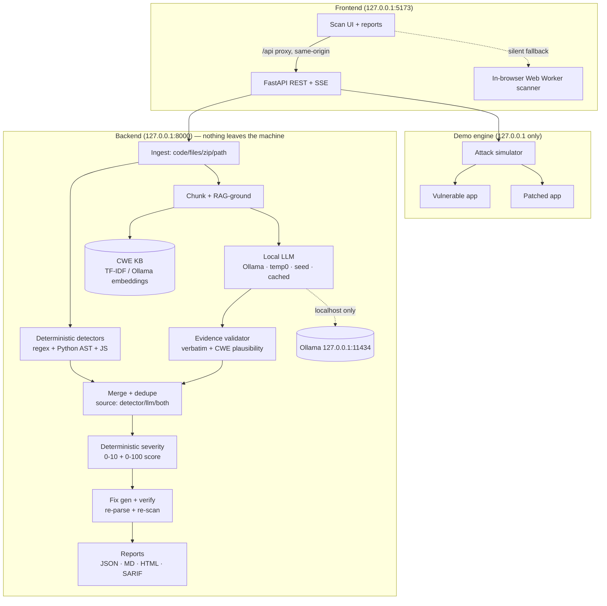

# 🐒 ChaosMonkey

**Shake the code before it ships.** ChaosMonkey is a security checkpoint for AI-generated
("vibe coded") code. It analyzes code **before deployment** to find vulnerabilities, exposed
API keys/secrets, and unsafe handling of personal data — grounds every finding in a CWE
knowledge base, validates it against the real code, scores severity deterministically, and
hands you a verified fix.

**Everything runs on your machine.** Analysis uses a self-hosted, deterministic local LLM
(Ollama) with an offline fallback, so proprietary code never leaves the device. The server
binds to `127.0.0.1` and refuses to start if any configured endpoint is non-local.

Built at Cal Hacks 13.0.

## Repository layout

| Folder | What's in it |
| --- | --- |
| [`frontend/`](frontend/) | React + Vite + TypeScript app: scanner UI, rule registry, reports. Fully offline. |
| [`backend/`](backend/) | FastAPI analysis pipeline, CWE RAG, local-LLM layer, reports, and the demo engine. |
| [`demo/`](demo/) | 3 deliberately vulnerable apps (vulnerable + patched) and the attack simulator. |
| [`data/`](data/) | `cwe_seed.json` — the grounded CWE knowledge base (32 entries). |
| [`scripts/`](scripts/) | `setup.sh`, `run.sh`, `build_cwe_seed.py`, `ingest_cwe.py`. |
| [`claude-code-plugin/`](claude-code-plugin/) | Claude Code plugin: offers a scan after Claude changes code, opens the report in the local UI, and applies only the fixes you approve. |

See [`API.md`](API.md) for the full endpoint contract.

## Architecture



## Quick start

### Backend
```bash
scripts/setup.sh            # venv + deps + CWE knowledge base (+ Ollama models if installed)
scripts/run.sh             # http://127.0.0.1:8000
# fully offline, no Ollama required:
LLM_MOCK=1 scripts/run.sh
```

### Frontend
```bash
cd frontend
npm install
npm run dev                # http://127.0.0.1:5173  (proxies /api to the backend)
```

The frontend works standalone (in-browser scanner). With the backend running it can also use
the richer pipeline and the demo engine; if the backend is off it falls back silently.

## API summary

| Method | Path | Purpose |
| --- | --- | --- |
| GET | `/api/health` | Model status, KB size, **privacy attestation** (`data_leaves_machine: false`). |
| POST | `/api/scan` | Scan pasted code / files / zip / a directory path → `scan_id`. |
| GET | `/api/scan/{id}` | Status + results. |
| GET | `/api/scan/{id}/events` | SSE: live per-stage and per-finding progress. |
| GET | `/api/scan/{id}/report?format=json\|md\|html\|sarif` | Export the report. |
| POST | `/api/scan/{id}/apply-fixes` | Patched copy + combined diff. |
| GET | `/api/cwe/{id}`, `/api/cwe/search?q=` | CWE knowledge base. |
| GET | `/api/determinism-check` | Run the same scan twice; prove identical output. |
| GET | `/api/demo/scenarios` | List demo scenarios. |
| POST | `/api/demo/{s}/attack\|scan\|fix\|replay\|full\|reset` | The live demo flow (SSE). |

Full details in [`API.md`](API.md).

## 90-second demo script (for judges)

1. **Health (5s).** `curl 127.0.0.1:8000/api/health` → `"data_leaves_machine": false`. Nothing
   leaves the machine; the model, seed, and parameters are attested.
2. **Attack the vulnerable app (20s).**
   `curl -N -X POST "127.0.0.1:8000/api/demo/flask_store/attack?target=vulnerable"`
   → watch **5/5 COMPROMISED**: SQL-injection login bypass, unauth `/admin` data dump, `../`
   path traversal of a canary file, reflected XSS, and a scraped (fake) API key.
3. **Scan it (20s).** `curl -N -X POST 127.0.0.1:8000/api/demo/flask_store/scan`
   → a grounded report: CWE-89, CWE-798, CWE-79, CWE-22, CWE-328, CWE-489… each with verbatim
   evidence and a verified fix. Security score ~60/100.
4. **Fix + re-attack (20s).** `curl -N -X POST 127.0.0.1:8000/api/demo/flask_store/full`
   → one stream: attack → scan → fix → **replay the same attacks → 0/5 COMPROMISED**, security
   score **60 → 80**.
5. **Determinism + privacy (10s).** `curl 127.0.0.1:8000/api/determinism-check` → `"identical": true`.
   Same input, byte-identical report, every time, all locally.

One-liner for the whole thing: the **Chaos Mode** toggle (`"chaos_mode": true` on `/api/scan`)
injects known-vulnerable snippets into a copy of your code and reports the detection rate — the
"monkey" shaking your code to prove the checker works.

## How the guarantees are enforced

- **No data leaves the machine.** The server binds to loopback, validates that Ollama's URL is
  localhost, and aborts startup otherwise. `/api/health` exposes `data_leaves_machine: false`.
  No cloud AI SDKs are imported anywhere.
- **No raw secrets in output.** Every secret/PII value is masked before it is logged, stored,
  returned, or placed in a report or fix diff; a defense-in-depth `scrub()` catches residuals.
- **Deterministic.** `temperature=0, top_k=1, top_p=1`, fixed seed, JSON-schema output with
  retry, content-hash caching, stable finding ids and ordering.
- **No hallucinations.** Every LLM finding must cite evidence that appears verbatim in the
  source, name a known CWE, and match that CWE's code pattern — otherwise it is rejected. Each
  finding records which checks it passed (`validation`), and detector-confirmed findings are
  marked `source: both`.
- **Verified fixes.** Each patch is applied to a temp copy, re-parsed (Python `ast` / `node
  --check` when available), and re-scanned; only then is it `fix_verified: true`.

## Limitations (honest)

- **Detectors are precision-oriented heuristics**, not a full dataflow/taint analysis. They can
  miss issues that need cross-function flow, and some AST rules are best-effort.
- The **JS/TS rules are regex + light parsing**, not a real JS parser, so deeply nested or
  obfuscated code can slip through. TS syntax isn't deeply checked when verifying fixes.
- **Fix generation is template + line-level**; complex refactors are flagged for manual review
  rather than auto-patched, and some fixes insert a guiding comment rather than a full rewrite.
- The **CWE KB is a 32-entry curated seed** (optionally enrichable from MITRE XML via
  `scripts/ingest_cwe.py`), not the complete corpus.
- **LLM quality depends on the local model.** Without Ollama the pipeline runs in
  detector-only / mock mode, which is deterministic but less expansive than a strong local LLM.
- The **demo apps are intentionally insecure** and bind to `127.0.0.1` only; never expose them.

---

Backend details: [`backend/README.md`](backend/README.md) · Frontend details:
[`frontend/README.md`](frontend/README.md).
